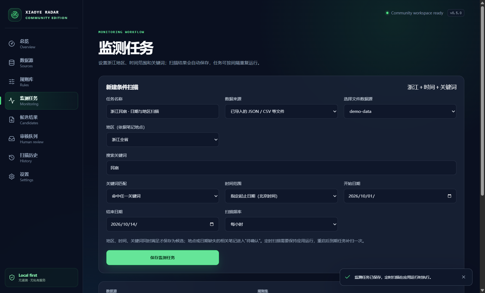
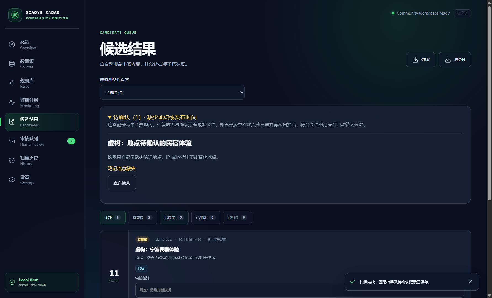

# 浙江地区、时间与关键词监测

`0.5.0` 在现有导入、规则、去重和人工审核流程上增加组合条件、应用内定时扫描与实验性小红书网页接入。



## 使用步骤

1. 打开“监测任务”，填写任务名称。
2. 数据来源选“小红书网页”，点击“打开小红书并登录”，在独立窗口正常完成登录。也可以先导入 JSON/CSV，然后选择“已导入的文件”。
3. 地区选浙江全省或杭州、宁波等城市。地区依据笔记明确的地点、`province`、`city`、`region`、`location` 或 `poi` 字段；正文提及浙江、作者信息和 IP 属地不算地点证据。
4. 输入关键词，使用中文或英文逗号分隔。支持命中任一关键词，或必须包含所有关键词；网页任务最多 20 个关键词。
5. 选择“最近 N 天”，或指定起止日期。起止日期按北京时间计算，包含开始当天 00:00:00 至结束当天 23:59:59.999；最近 N 天以每轮扫描时刻向前计算。
6. 选仅手动、每 15/30 分钟、每小时、每 6 小时或每天。保存任务后点击“立即扫描”，之后保持应用运行即可按间隔扫描。
7. 在“候选结果”按监测条件查看，并导出 CSV/JSON。CSV 额外保存地点、规则 ID 和规则修订，方便追溯。导出包含所选条件下所有审核状态的候选；待确认记录单独保存在工作区。

地点和日期同时可确认、时间在范围内、关键词满足规则的记录才进入候选。命中关键词但缺少地点或日期的内容单独进入“待确认”，不会当作已满足条件的结果。补充原始文件的字段后再扫描，符合条件的待确认内容会转为候选。未匹配或被过滤的内容仍保留在最近一次数据源副本中；各轮扫描保存统计与失败原因。



## 小红书网页接入的实际范围

这是独立编写的实验性浏览器接入，没有使用 Pro 私有代码。它打开正常网页搜索并读取当前登录账号能访问的笔记正文和公开字段，不调用私有 API，不提取 Cookie、会话令牌或请求签名，不处理验证码或规避访问限制。

- 每轮最多读取 1–100 条笔记，默认 30 条；每个搜索最多滚动 5 次。多个 OR 关键词按剩余配额分配笔记数量，AND 关键词合并为一次搜索。
- 搜索使用平台返回的顺序，不承诺最新排序、全站完整结果或历史内容的完整覆盖。地区和日期在取得笔记后严格筛选，不能让平台返回其本来不提供的地区结果。
- 使用正常浏览器会话，不进行并发笔记请求；每次导航后等待 1.8 秒，相邻笔记额外等待 2 秒；每次导航最多等待 30 秒。
- 登录失效、验证、访问限制或页面结构变化时保存错误并暂停该任务。请打开小红书窗口处理后手动启用；不会自动重试验证。
- 笔记地点不存在或仅有无法定位的场所名时标为待确认。没有日期的内容不会用采集时刻代替发布时间；“昨天”“10-12”等无完整年份标签不推断日期。
- 公开笔记结构、正常页面 DOM 和本地合成数据已测试；真实账号登录后的搜索和页面兼容性需要使用者验收。平台网页变化可能要求修改接入模块。
- 浏览器会话仅保存在本机专用 Electron partition `persist:xiaoye-xiaohongshu-v1`，无 Node.js、Preload 或 IPC 能力；应用工作台的 IPC 不暴露给远程页面。笔记保存为规范原文 URL，去掉临时查询参数；平台可能要求重新搜索或登录才能打开该原文。

## 定时扫描与保存

任务每 30 秒检查一次到期状态，因此可能有最多约 30 秒的启动延迟。多个到期任务串行执行；同一数据源不会重叠扫描。每轮结束后按设置间隔安排下一轮，重启应用后已经到期的任务补扫一次，不补跑所有遗漏的轮次。

定时扫描要求应用保持运行。关闭主窗口会退出应用并停止扫描；当前版本没有后台系统服务、开机启动或 Windows 任务计划。计划配置、上次执行、下次执行与错误保存在本地，暂停期间不会启动新扫描；已经开始的一轮会完成保存。

文件源每轮从首次选择的原文件路径重新读取，而非重复扫描冻结的导入副本。原文件移动、删除或内容损坏会记录失败；旧版本导入记录没有原文件路径时仍按已有副本扫描。所有原始路径仅保存在本机，诊断不会公开路径。

工作区继续使用 schema version 1，新字段都有向后兼容默认值；旧任务默认仅手动执行，旧候选和审核状态保留。旧版应用不能读取新字段，请在升级前备份数据目录，并用新版读取升级后的工作区。

保存上限为 10,000 条候选、2,000 条待确认和 2,000 次扫描历史；超限淘汰最旧记录。需要长期存档时定期导出 CSV/JSON 并备份设置页显示的数据目录。文件源保存最近一次规范化副本，不保存每一轮完整输入快照。

## 文件字段示例

以下内容完全虚构；也可以导入 [示例 JSON](../examples/zhejiang-monitoring/demo-data.json)。

```json
[
  {
    "id": "synthetic-zhejiang-1",
    "title": "虚构民宿体验",
    "content": "浙江民宿与露营体验，仅用于演示。",
    "author": "虚构作者",
    "publishedAt": "2026-10-12T10:00:00+08:00",
    "url": "https://example.invalid/synthetic/1",
    "location": { "province": "浙江", "city": "杭州" }
  }
]
```

CSV/JSON 同时支持 `标题`、`正文`、`作者`、`发布时间`、`链接`、`地点`、`省份`、`城市`、`地区` 列名。日期建议提供带时区的 ISO 8601。规范化 JSON 的 `metadata.location` 等嵌套地区字段也支持，并继续删除敏感 metadata。

规则也可以在规则库保存 YAML：

```yaml
id: zhejiang-stay
name: 浙江民宿近七天
include: [民宿, 露营]
include_mode: any
region:
  province: 浙江
  cities: []
time_window:
  days: 7
basic_score: 1
minimum_score: 1
deduplication: id
```

指定日期时用 `time_window.start` 和 `time_window.end`，必须是带时区的完整 ISO 时间。若同时设置 `days` 与日期范围，则两项都必须满足。
